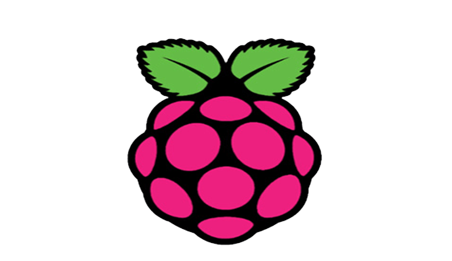

   <h1>Hi there, I'm <a href="https://www.electronicssimplified.in/">Rolan Pereira</a>  
   </h1>   

   &nbsp;&nbsp;
&nbsp;&nbsp;
&nbsp;&nbsp;
 &nbsp;&nbsp;
 &nbsp;&nbsp;
 

<h3> 🙎 Rolan Pereira | 💻 IoT and Developer | Hardware Prototyping |  | Maldives , India</h3>

 <h5 align="center">
   <i>⚡️I don’t trust people who dont use promises.⚡️</i>
  </h5>
 
 
 

  
  <h3> STEM educator with a vision.</h3>

|||  I contribute to STEM education for a better Future. If you want to see my content. Please visit my website : <a href="www.electronicssimplified.in ">Electronics Simplified</a> |||

- 🥀 Learning System Design & Teaching how to Simplify
   <i>with Electronics, RasperryPi, Arduinom Python, JavaScript, React and many others.</i>

- Making Good Use of Silicon

- Living like an 👽.

- I do Development in a bit of everything.

- All About living a simple life and eating good food🌯.

- 💬 Connect? lets get social (rolanpereira3@gmail.com) . Thats how social i am !

 

  <h4> IoT | Competitive Programming | Designing | Music </h4>
   

<!--  -->

 

### - Languages and Tools ()

  
      
  
  
  
  
  
  
  
  
  

Buy me a coffee for motivation.

<!--
### - Blogs 🌱
-->
<!--

  

-->

 

<h2 align="center">🤝 Support</h2>

🎀 Contributions (<a href="https://guides.github.com/introduction/flow" title="GitHub flow">GitHub Flow</a>), 🔥 issues, and 🥮 feature requests are most welcome!

💙 If you like my projects, Give them ⭐ and Share it with friends!

Made with ❤️ in India

<h1 align='center'>⚡️<i>Drink Water!</i>⚡️</h1>
